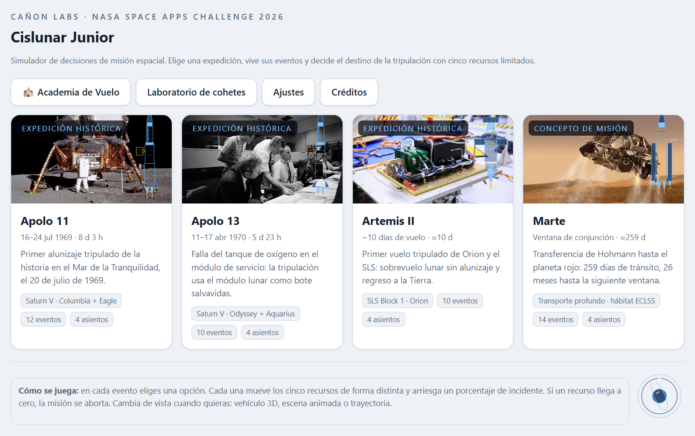

# Cislunar Junior — Simulador de decisiones de misión espacial

**Cañon Labs · NASA Space Apps Challenge 2026**

Simulador interactivo en el navegador sobre misiones espaciales reales (Apolo 11, Apolo 13, Artemis II y Marte). El jugador gestiona recursos (soporte vital, energía, protección radiación, agua/alimento, propelente) tomando decisiones por evento, y puede volar la misión en un simulador 3D inmersivo con cabina WebGL, o en modo 2D clásico. Incluye Academia de Vuelo (10 lecciones) y Laboratorio de cohetes (diseño de vehículos).

## Características

- **4 misiones históricas/futuras**: Apolo 11, Apolo 13, Artemis II, Marte.
- **Simulador de vuelo** con física real (gravedad + J2, atmósfera rotatoria, arrastre Mach-dependiente, empuje vectorial, integración Verlet, actitud por cuaterniones, SAS asistido).
- **Cabina 3D inmersiva** (WebGL, GLSL) con 6 monitores + pantalla central, o fallback 2D.
- **Multijugador local** vía `BroadcastChannel`.
- **Academia de Vuelo**: 10 lecciones progresivas con medallas y certificado.
- **Laboratorio de cohetes**: constructor de vehículos por etapas, presupuesto Δv (Tsiolkovski), TWR, simulación de ascenso.
- **Sin dependencias**: HTML5/CSS3/JS puro, sin frameworks ni build.

## Ejecución

No requiere instalación.

```bash
# Opción 1: abrir directamente
# doble clic en index.html  o  "Cislunar Junior - Cañon Labs.html"

# Opción 2: servidor estático
cd "Cislunar Junior"
python -m http.server 8899
# abrir http://localhost:8899/
```

### Pruebas (Node.js)

```bash
node tools\prueba_simulador.js
node tools\prueba_cabina.js
node tools\prueba_orbital.js
node tools\prueba_mision.js
node tools\prueba_vehiculos.js
node tools\prueba_lab.js
```

## Estructura

```
Cislunar Junior/
├── Cislunar Junior - Cañon Labs.html  # entrada principal (standalone)
├── js/                            # 19 módulos (orbital, vehiculo, flight, stages, mision_vuelo, cabina, cockpit, hud_flight, controls, academia, laboratorio, glcore, ...)
├── assets/                         # fotos NASA (dominio público)
├── tools/                          # pruebas, capturas CDP, guiones JSON, análisis APK
├── docs/screenshots/               # capturas
├── README.md
└── README-CABINA-ORION.md          # spec de cabina Orion
```

## Controles (vuelo)

| Tecla | Acción |
|---|---|
| W/S o ↑/↓ | Pitch |
| A/D o ←/→ | Yaw |
| Q/E | Roll |
| Shift / Espacio | Throttle + / − |
| H | Ciclar asistencia (0–3) |
| C | Ciclar cámara |
| R | Reset actitud |
| P | Pausa |
| Tab / F1–F6 | Monitores de cabina |
| `` ` `` | Alternar modo ratón/teclado |

## Capturas



## Recursos gráficos

Imágenes NASA de dominio público (ver `js/creditos.js`):

| Archivo | NASA ID | Contenido |
|---|---|---|
| `assets/apolo11.jpg` | as11-40-5927 | Módulo lunar Apolo 11 |
| `assets/apolo13.jpg` | S70-34902 | Control de misión Apolo 13 |
| `assets/artemis2.jpg` | KSC-20230602-PH-GEB01-0010 | Módulo tripulado Orion (Artemis II) |
| `assets/marte.jpg` | PIA14838 | Curiosity (concepto artístico) |

Arte original (iconos vectoriales, modelos 3D procedurales MD2, emblema animado) © Cañon Labs.

## Créditos

Datos de misión: NASA (Apolo 11/13, Artemis II, Marte). Imágenes: dominio público NASA. Desarrollo: Cañon Labs.

## Licencia

Código del proyecto © Cañon Labs. Imágenes NASA en dominio público.
