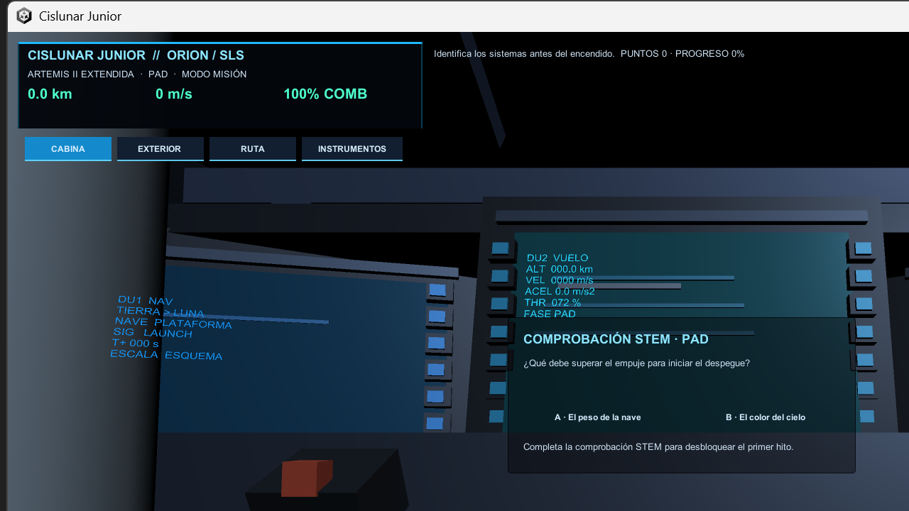
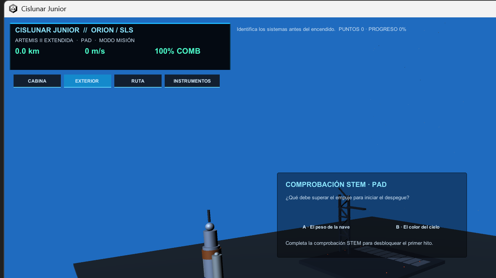
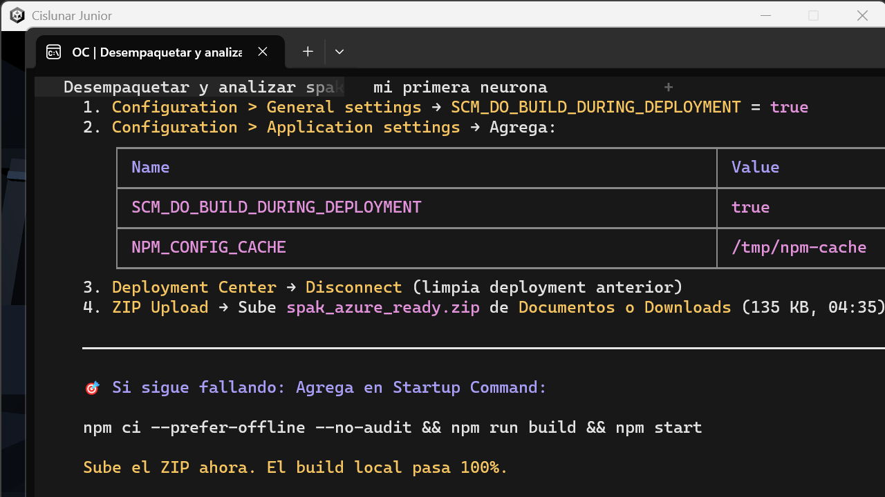
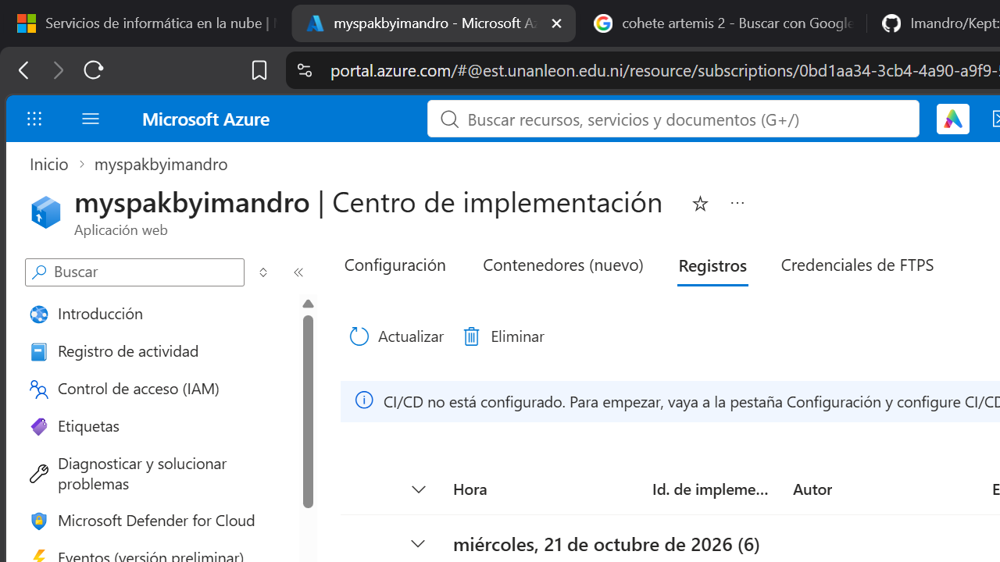
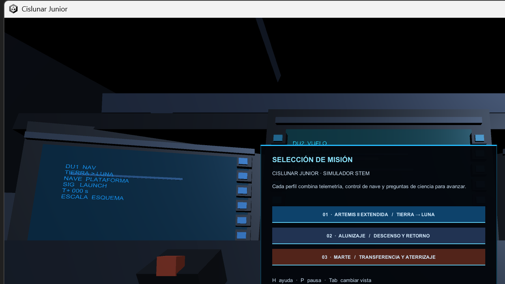

# Cislunar Junior

Simulador educativo de misiones cislunares y planetarias, construido con **Unity 6** (6000.6.6f1). Combina una cabina Orion con tres pantallas DU, una vista exterior con un vehículo SLS/Orion animado, y una ruta heliocéntrica, para enseñar propulsión, combustible, altitud, velocidad, fases orbitales y destinos.

> Proyecto de **Cañón Labs** · NASA Space Apps Challenge 2026.

## Capturas

| Cabina Orion (DU1/DU2/DU3) | Vista exterior (SLS) |
|---|---|
|  |  |

| En vuelo (800×700) | Escena completa |
|---|---|
|  |  |



## Tecnologías

- **Motor**: Unity 6 (6000.6.6f1, revision `d20c9ac777da`)
- **Lenguaje**: C# (Unity scripts)
- **UI**: Unity UGUI 2.6.0 + Vector Graphics (`com.unity.modules.vectorgraphics`)
- **Física**: módulo `com.unity.modules.physics` + `physicscore2d`
- **Tests**: Unity Test Framework 1.8.0 (EditMode + PlayMode)
- **Integración MCP**: `com.gamelovers.mcp-unity` (servidor MCP para Codex/Claude)
- **Assets 3D**: FBX de la NASA (SLS Block 1, Orion) + texturas oficiales (Artemis II)
- **Build**: Windows (x64), generada con `Cislunar > Build Windows`
- **Render**: ventana 1024×304 para los displays de cabina, escena exterior con bounds dinámicos

## Características

- **Cabina Orion** con tres Display Units (DU1/DU2/DU3) compartiendo el estado de la misión.
- **Vista exterior** con vehículo SLS animado: cuenta regresiva, encendido, ascenso, separación SRB, separación de etapa central, ICPS, vuelo Orion, descenso, reentrada y splashdown.
- **Ruta heliocéntrica** con segmentos, hitos, distancia, error de trayectoria, delta-v requerido y ventana de maniobra.
- **Tres perfiles educativos**: Artemis II extendida, alunizaje (Apollo 11) y Marte.
- **Modo vuelo libre**: experimentar sin preguntas obligatorias.
- **Modo misión**: estudiar cada fase de forma controlada (opción conservadora vs. arriesgada).
- **Atmósfera y estrellas** que cambian con la altitud y el cuerpo celeste.
- **Plume, humo, torre móvil, paneles solares** como visuales educativos.

## Controles

| Tecla / acción | Efecto |
|---|---|
| Clic en DU1/DU2/DU3 o F1/F2/F3 | Enfocar pantalla física |
| Esc | Volver al encuadre general |
| Botón derecho + arrastre | Mirar en Cabina/Instrumentos |
| W/S | Ajustar potencia en Exterior |
| A/D | Guiñada; flechas: cabeceo y alabeo |
| N | Avanzar fase o solicitar separación autorizada |
| Espacio | Activar vuelo libre |
| Tab | Alternar Cabina / Exterior / Ruta |
| 1, 2, 3 | Artemis II, Alunizaje, Marte |
| Esc | Cerrar tutorial |

## Estructura del proyecto

```
CislunarJunior/
├── Assets/
│   ├── Scripts/          # Lógica de misión, vuelo, cabina, exterior, ruta
│   ├── Scenes/           # CislunarJunior.unity (escena principal)
│   ├── Resources/NASA/   # Assets oficiales (SLS FBX, texturas Artemis II)
│   └── Art/              # Materiales y shaders
├── Packages/             # manifest.json (dependencias)
├── ProjectSettings/      # Configuración de Unity
├── Tools/                # Scripts Python de exportación NASA
├── Builds/               # Builds de Windows (ignoradas en git)
└── README.md             # Detalles técnicos y controles
```

## Cómo abrir

1. Abre `CislunarJunior/` desde **Unity Hub** con **Unity 6000.6.6f1**.
2. Abre `Assets/Scenes/CislunarJunior.unity`.
3. Ejecuta la escena.

Consulta [CislunarJunior/README.md](CislunarJunior/README.md) para controles, build de Windows y detalles técnicos.

## Build de Windows

En Unity, usa `Cislunar > Build Windows`. La build se genera en `Builds/Windows/CislunarJunior-Orion.exe`.

## Pruebas

Las pruebas automatizadas se ejecutan desde **Test Runner** en Unity:

- **EditMode**: 23 pruebas
- **PlayMode**: 12 pruebas

Estado verificado de esta etapa:

- Ascenso continuo después de la cuenta regresiva; `RocketRoot` deja el deck.
- Tres núcleos visuales RS-25; humo desacoplado de `RocketRoot`, limitado a baja altitud.
- Plataforma y torre se ocultan por despeje; atmósfera y estrellas cambian con altitud/cuerpo.
- SRB/core se separan con autorización; Orion queda única tras ICPS.
- Cabina excluye `ExteriorLayer`; ventana conserva render exterior sincronizado.
- Build Windows verificada en Unity 6000.6.6f1.

## Objetivo educativo

Cada perfil explica la relación entre propulsión, combustible, altitud, velocidad, fases orbitales y destino. El modo vuelo libre permite experimentar; el modo misión permite estudiar cada fase de forma controlada.

## MCP Unity

El paquete se declara en `Packages/manifest.json`. Tras abrir Unity, iniciar el servidor desde `Tools > MCP Unity > Server Window` y configurar Codex con el ejecutable generado por el paquete.

## Assets de terceros

Los assets de la NASA (SLS Block 1, Orion) se usan bajo dominio público. Ver [THIRD-PARTY-NOTICES.md](CislunarJunior/THIRD-PARTY-NOTICES.md).

## Licencia

Ver [LICENSE](LICENSE) (si existe). El código de Cislunar Junior es obra original de Cañón Labs para el NASA Space Apps Challenge 2026.
